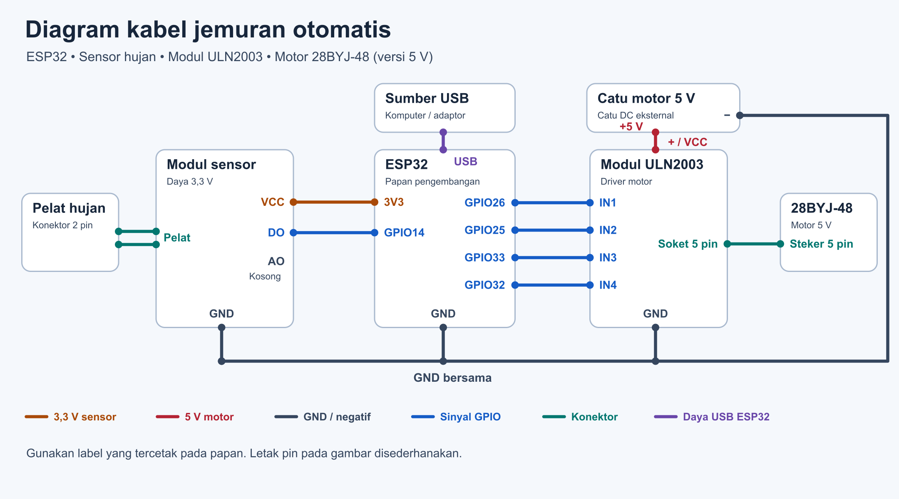

# Jemuran Otomatis ESP32

Prototipe jemuran yang menarik tali masuk saat sensor hujan basah dan mengulurkannya kembali saat sensor kering. ESP32 membaca keluaran digital sensor dan mengendalikan motor stepper 28BYJ-48 melalui modul ULN2003.

## Cara kerja

1. Saat ESP32 menyala atau direset, sketch mengasumsikan jemuran berada di luar.
2. ESP32 membaca pin `DO` sensor melalui `GPIO14`. Sketch mengharapkan `LOW` saat basah dan `HIGH` saat kering. Bacaan harus stabil selama 500 ms sebelum memicu gerakan.
3. Jika sensor basah dan jemuran tercatat di luar, motor menarik tali masuk. Arah yang diinginkan adalah berlawanan arah jarum jam, dilihat dari sisi poros.
4. Jika sensor kering dan jemuran tercatat di dalam, motor mengeluarkan tali searah jarum jam. Status posisi diperbarui setelah gerakan selesai, lalu ESP32 melanjutkan pembacaan sensor.

## Diagram kabel



| Dari | Ke |
| --- | --- |
| ESP32 `GPIO26` | ULN2003 `IN1` |
| ESP32 `GPIO25` | ULN2003 `IN2` |
| ESP32 `GPIO33` | ULN2003 `IN3` |
| ESP32 `GPIO32` | ULN2003 `IN4` |
| Sensor hujan `DO` | ESP32 `GPIO14` |
| ESP32 `3V3` | Sensor hujan `VCC` |
| Catu motor `+5 V` | ULN2003 `+ / VCC` |
| Catu motor negatif | GND ESP32, sensor, dan ULN2003 |
| Steker 5 pin motor | Soket motor pada modul ULN2003 |
| Pelat sensor | Konektor 2 pin pada modul sensor |

ESP32 mendapat daya lewat USB. Diagram mengasumsikan sensor mendukung suplai 3,3 V dan motor berlabel 5 V. Jika keluaran `DO` sensor mencapai 5 V, gunakan penyesuai level sebelum menyambungkannya ke ESP32. Biarkan `AO` kosong. Ikuti label pada papan saat memasang kabel.

## Flowchart


## Kompilasi untuk ESP32 Dev Module

### Arduino IDE

1. Jika paket ESP32 belum tersedia, tambahkan URL `https://espressif.github.io/arduino-esp32/package_esp32_index.json` ke **Additional Boards Manager URLs** di pengaturan Arduino IDE.
2. Di **Boards Manager**, instal **esp32 by Espressif Systems** versi **3.3.12**. Di **Library Manager**, instal **Stepper by Arduino** versi **1.1.3**.
3. Buka [jemuran-otomatis-esp32.ino](jemuran-otomatis-esp32.ino), pilih **ESP32 Dev Module** di menu **Tools → Board**, lalu klik **Verify**. Kompilasi bisa dilakukan tanpa menyambungkan papan.

### Arduino CLI

Jalankan dari folder proyek `jemuran-otomatis-esp32`. Tiga perintah pertama menyiapkan paket board dan library untuk instalasi baru.

```sh
arduino-cli core update-index --additional-urls https://espressif.github.io/arduino-esp32/package_esp32_index.json
arduino-cli core install esp32:esp32@3.3.12 --additional-urls https://espressif.github.io/arduino-esp32/package_esp32_index.json
arduino-cli lib install Stepper@1.1.3
arduino-cli compile --fqbn esp32:esp32:esp32 --warnings all .
```

### Hasil kompilasi

Kompilasi untuk `esp32:esp32:esp32` berhasil tanpa error atau peringatan menggunakan core ESP32 3.3.12 dan Stepper 1.1.3.

| Penggunaan | Terpakai | Kapasitas |
| --- | ---: | ---: |
| Flash program | 272.848 byte (20%) | 1.310.720 byte |
| RAM untuk variabel global | 22.164 byte (6%) | 327.680 byte |

## Upload kode ke ESP32

Pastikan paket board ESP32 dan library Stepper sudah terpasang sesuai bagian **Arduino IDE** di atas.

| Tombol Arduino IDE | Fungsi |
| --- | --- |
| **Verify** (ikon centang) | Mengompilasi sketch untuk memeriksa error. Bisa dijalankan tanpa papan terhubung. |
| **Upload** (ikon panah kanan) | Mengompilasi sketch, lalu menulis program ke memori ESP32 melalui USB. |

1. Sambungkan ESP32 ke komputer dengan kabel USB yang mendukung transfer data.
2. Buka [jemuran-otomatis-esp32.ino](jemuran-otomatis-esp32.ino) di Arduino IDE.
3. Pilih **ESP32 Dev Module** pada **Tools → Board**, lalu pilih port ESP32 pada **Tools → Port**.
4. Untuk uji pertama, lepas tali dan ubah `langkahPerGerakan` menjadi `256`. Posisikan jemuran di luar karena kode menganggap posisi tersebut sebagai kondisi awal.
5. Klik **Upload** dan tunggu sampai Arduino IDE menampilkan bahwa upload selesai. Program akan mulai berjalan setelah ESP32 reset.
6. Buka Serial Monitor pada **115200 baud** untuk melihat pesan sensor dan gerakan jemuran.

Setelah upload berhasil, program tersimpan di ESP32 dan berjalan kembali setiap kali papan mendapat daya. Upload ulang setiap kali sketch diubah.

## Troubleshooting upload ESP32

### Port ESP32 tidak muncul

1. Coba kabel USB data lain dan port USB lain. Sambungkan langsung ke komputer jika memungkinkan, lalu cabut dan pasang kembali ESP32. Periksa indikator daya.
2. Buka kembali **Tools → Port** untuk memperbarui daftar. Di macOS, periksa **System Information → Hardware → USB**. Di Windows, periksa **Device Manager**. Bandingkan daftar saat papan dicabut dan dipasang untuk mengenali perangkat ESP32.
3. Jika komputer mendeteksi perangkat USB tetapi port serial belum tersedia, identifikasi chip USB-to-UART pada papan, misalnya CP210x atau CH340/CH341. Instal driver yang sesuai dari produsen chip jika diperlukan. Panduan koneksi Espressif menyediakan tautan driver CP210x dan FTDI.
4. Jika port muncul sebagai **Unknown**, pilih port tersebut dan tentukan **ESP32 Dev Module** secara manual. Periksa kembali port setelah papan disambungkan ulang.

Rujukan langkah deteksi perangkat dan driver tersedia di [panduan Arduino](https://support.arduino.cc/hc/en-us/articles/4412955149586-If-your-board-is-not-detected-by-Arduino-IDE) dan [panduan koneksi serial Espressif](https://docs.espressif.com/projects/esp-idf/en/stable/esp32/get-started/establish-serial-connection.html).

### Upload berhenti di “Connecting…”

1. Pastikan **Tools → Board** memakai **ESP32 Dev Module** dan **Tools → Port** memakai port papan yang terhubung.
2. Tutup Serial Monitor, Serial Plotter, serta aplikasi terminal lain yang memakai port ESP32, lalu ulangi **Upload**.
3. Jika tetap berhenti di **Connecting…**, masuk ke mode download secara manual. Tahan tombol **BOOT**, tekan dan lepaskan **EN/RESET** satu kali, lalu lepaskan **BOOT**. Klik **Upload** kembali.
4. Jika koneksi masih gagal atau penulisan terputus, pilih **Tools → Upload Speed → 115200** dan ulangi upload. Pengaturan ini mengatur kecepatan upload. Serial Monitor untuk sketch ini juga diatur ke 115200 baud.
5. Jika masih gagal, cabut USB dan matikan catu motor sebelum melepas kabel sensor serta ULN2003 dari ESP32. Sambungkan kembali ESP32 ke USB saja dan coba upload untuk memeriksa apakah rangkaian eksternal mengganggu koneksi atau kestabilan daya.
6. Setelah berhasil, matikan daya sebelum memasang kembali kabel sesuai diagram. Posisikan jemuran di luar sebelum menyalakan kembali sistem. Jika program belum berjalan setelah upload manual, tekan **EN/RESET** satu kali dengan **BOOT** dilepas.

Panduan ini mengikuti [troubleshooting esptool](https://docs.espressif.com/projects/esptool/en/latest/esp32/troubleshooting.html) dan [langkah mode download manual Espressif](https://docs.espressif.com/projects/esp-idf/en/stable/esp32/get-started/establish-serial-connection.html).

## Troubleshooting sensor dan motor

Matikan USB dan catu motor sebelum mengubah sambungan kabel. Untuk pengujian gerakan, lepas tali dan gunakan jumlah langkah kecil agar kondisi sensor dan motor mudah diamati.

### Sensor hujan tidak merespons

1. Periksa sambungan pelat ke modul sensor, lalu pastikan `VCC → 3V3`, `GND → GND`, dan `DO → GPIO14`. Gunakan modul yang mendukung suplai 3,3 V serta level sinyal yang sesuai ESP32.
2. Teteskan air pada jalur logam pelat dan keringkan kembali. Jika modul memiliki trimpot sensitivitas, putar sedikit demi sedikit sampai keluaran digital berubah antara kondisi basah dan kering. Amati LED status jika tersedia.
3. Buka Serial Monitor pada **115200 baud** sebelum membasahi pelat. Sketch mengharapkan `LOW (0)` saat basah dan `HIGH (1)` saat kering. Untuk melihat bacaan mentah, tambahkan sementara `Serial.println(bacaan);` tepat setelah baris `const int bacaan = digitalRead(pinHujan);`, lalu upload ulang. Setelah pemeriksaan, hapus baris diagnostik tersebut dan upload kembali.
4. Jika bacaan tetap sama, cek ulang kabel DO dan GND, atur sensitivitas, serta bersihkan dan keringkan pelat. Jika bacaan terbalik, sesuaikan kedua kondisi LOW/HIGH pada sketch dengan hasil pengukuran modul.
5. Jika bacaan berubah tetapi motor diam, cek status posisi. Saat awal menyala, kondisi kering tidak memicu gerakan karena jemuran sudah dicatat berada di luar. Uji urutan **basah → motor masuk → kering → motor keluar**. Setiap kondisi harus bertahan minimal **500 ms**. Sensor dibaca kembali setelah gerakan motor selesai.
6. Jika Serial Monitor menampilkan pesan gerakan tetapi poros tidak berputar, lanjutkan pemeriksaan motor di bawah.

Pengaturan sensitivitas melalui trimpot dan perbedaan DO/AO dijelaskan pada [panduan modul sensor hujan HandsOn Tech](https://handsontec.com/index.php/product/rain-drop-sensor-module/). Cocokkan spesifikasi dengan modul yang digunakan.

### Motor hanya bergetar dan tidak berputar

1. Periksa label input ULN2003 dan kabel ESP32. Sambungan harus mengikuti `GPIO26 → IN1`, `GPIO25 → IN2`, `GPIO33 → IN3`, dan `GPIO32 → IN4`. Pastikan steker 5 pin motor terpasang penuh.
2. Pertahankan urutan argumen pada sketch, yaitu `Stepper motor(langkahPerPutaran, pinIN1, pinIN3, pinIN2, pinIN4);`. Urutan fase yang salah atau satu sambungan yang terputus perlu diperiksa saat motor hanya bergetar.
3. Untuk motor berlabel **5 V**, periksa catu 5 V eksternal ke terminal `+ / VCC` ULN2003 dan satukan GND catu, driver, serta ESP32. Gunakan catu dengan kemampuan arus sesuai motor dan ukur apakah tegangannya turun saat motor bergerak. Suplai motor mengikuti diagram kabel.
4. Uji tanpa beban tali. Ubah sementara `kecepatanRPM` dari `10` menjadi `5` dan `langkahPerGerakan` menjadi `256`, lalu upload ulang. Jika motor berputar tanpa beban, periksa gesekan mekanik, ketegangan tali, dan kemampuan motor menarik beban sebelum mengkalibrasi kembali langkah.
5. Jika masih bergetar, matikan daya lalu periksa kabel yang longgar atau putus. Coba kabel pengganti, modul ULN2003 lain, atau motor lain secara bergantian untuk menemukan komponen penyebabnya.
6. Setelah satu perintah selesai, kode mencatat posisi baru meskipun motor macet. Untuk mengulang dari kondisi awal, posisikan jemuran di luar dan reset ESP32. Ubah `arahMasuk` jika arah putaran terbalik setelah motor sudah dapat berputar.

## Uji gerakan jemuran

1. Basahi pelat dan periksa putaran dari sisi poros. Jika gerakan masuk searah jarum jam, ubah `arahMasuk` dari `-1` ke `1`, lalu upload ulang. Keringkan pelat untuk menguji arah keluar.
2. Setelah arah sesuai, pasang tali dan kalibrasi `langkahPerGerakan` untuk panjang tarikan, lalu upload ulang. Posisikan jemuran di luar setiap kali ESP32 dinyalakan atau direset.

Sketch menghitung langkah yang diperintahkan dan menyimpan status posisi di RAM. Jika motor macet atau ESP32 reset di tengah gerakan, posisi fisik bisa berbeda dari status di kode. Selama `motor.step()` berlangsung, pembacaan sensor dijeda.
