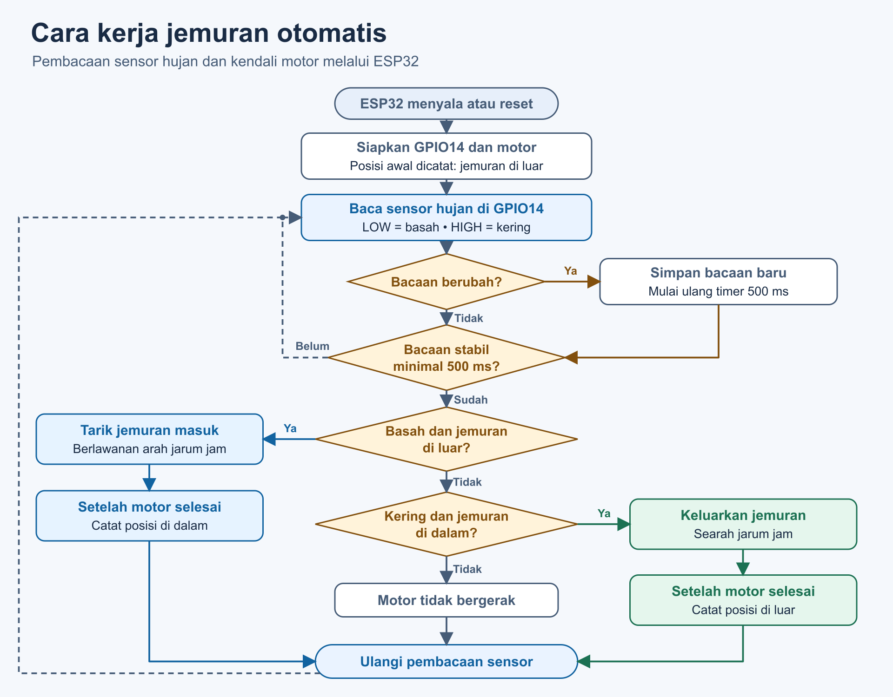

# Jemuran Otomatis ESP32

Prototipe jemuran yang menarik tali masuk saat sensor hujan basah dan mengulurkannya kembali saat sensor kering. ESP32 membaca keluaran digital sensor dan mengendalikan motor stepper 28BYJ-48 melalui modul ULN2003.

## Cara kerja

1. Saat ESP32 menyala atau direset, sketch mengasumsikan jemuran berada di luar.
2. ESP32 membaca pin `DO` sensor melalui `GPIO14`. Sketch mengharapkan `LOW` saat basah dan `HIGH` saat kering. Bacaan harus stabil selama 500 ms sebelum memicu gerakan.
3. Jika sensor basah dan jemuran tercatat di luar, motor menarik tali masuk. Arah yang diinginkan adalah berlawanan arah jarum jam, dilihat dari sisi poros.
4. Jika sensor kering dan jemuran tercatat di dalam, motor mengeluarkan tali searah jarum jam. Status posisi diperbarui setelah gerakan selesai, lalu ESP32 melanjutkan pembacaan sensor.

## Diagram kabel


| Dari | Ke |
| --- | --- |
| ESP32 `GPIO26` | ULN2003 `IN1` |
| ESP32 `GPIO25` | ULN2003 `IN2` |
| ESP32 `GPIO33` | ULN2003 `IN3` |
| ESP32 `GPIO32` | ULN2003 `IN4` |
| Sensor hujan `DO` | ESP32 `GPIO14` |
| ESP32 `3V3` | Sensor hujan `VCC` |
| Catu motor `+5 V` | ULN2003 `+ / VCC` |
| Catu motor negatif | GND ESP32, sensor, dan ULN2003 |
| Steker 5 pin motor | Soket motor pada modul ULN2003 |
| Pelat sensor | Konektor 2 pin pada modul sensor |

ESP32 mendapat daya lewat USB. Diagram mengasumsikan sensor mendukung suplai 3,3 V dan motor berlabel 5 V. Jika keluaran `DO` sensor mencapai 5 V, gunakan penyesuai level sebelum menyambungkannya ke ESP32. Biarkan `AO` kosong. Ikuti label pada papan saat memasang kabel.

## Flowchart



## Kompilasi untuk ESP32 Dev Module

### Arduino IDE

1. Jika paket ESP32 belum tersedia, tambahkan URL `https://espressif.github.io/arduino-esp32/package_esp32_index.json` ke **Additional Boards Manager URLs** di pengaturan Arduino IDE.
2. Di **Boards Manager**, instal **esp32 by Espressif Systems** versi **3.3.12**. Di **Library Manager**, instal **Stepper by Arduino** versi **1.1.3**.
3. Buka [jemuran-otomatis-esp32.ino](jemuran-otomatis-esp32.ino), pilih **ESP32 Dev Module** di menu **Tools → Board**, lalu klik **Verify**. Kompilasi bisa dilakukan tanpa menyambungkan papan.

### Arduino CLI

Jalankan dari folder proyek `jemuran-otomatis-esp32`. Tiga perintah pertama menyiapkan paket board dan library untuk instalasi baru.

```sh
arduino-cli core update-index --additional-urls https://espressif.github.io/arduino-esp32/package_esp32_index.json
arduino-cli core install esp32:esp32@3.3.12 --additional-urls https://espressif.github.io/arduino-esp32/package_esp32_index.json
arduino-cli lib install Stepper@1.1.3
arduino-cli compile --fqbn esp32:esp32:esp32 --warnings all .
```

### Hasil kompilasi

Kompilasi untuk `esp32:esp32:esp32` berhasil tanpa error atau peringatan menggunakan core ESP32 3.3.12 dan Stepper 1.1.3.

| Penggunaan | Terpakai | Kapasitas |
| --- | ---: | ---: |
| Flash program | 272.848 byte (20%) | 1.310.720 byte |
| RAM untuk variabel global | 22.164 byte (6%) | 327.680 byte |

## Upload kode ke ESP32

Pastikan paket board ESP32 dan library Stepper sudah terpasang sesuai bagian **Arduino IDE** di atas.

| Tombol Arduino IDE | Fungsi |
| --- | --- |
| **Verify** (ikon centang) | Mengompilasi sketch untuk memeriksa error. Bisa dijalankan tanpa papan terhubung. |
| **Upload** (ikon panah kanan) | Mengompilasi sketch, lalu menulis program ke memori ESP32 melalui USB. |

1. Sambungkan ESP32 ke komputer dengan kabel USB yang mendukung transfer data.
2. Buka [jemuran-otomatis-esp32.ino](jemuran-otomatis-esp32.ino) di Arduino IDE.
3. Pilih **ESP32 Dev Module** pada **Tools → Board**, lalu pilih port ESP32 pada **Tools → Port**.
4. Untuk uji pertama, lepas tali dan ubah `langkahPerGerakan` menjadi `256`. Posisikan jemuran di luar karena kode menganggap posisi tersebut sebagai kondisi awal.
5. Klik **Upload** dan tunggu sampai Arduino IDE menampilkan bahwa upload selesai. Program akan mulai berjalan setelah ESP32 reset.
6. Buka Serial Monitor pada **115200 baud** untuk melihat pesan sensor dan gerakan jemuran.

Setelah upload berhasil, program tersimpan di ESP32 dan berjalan kembali setiap kali papan mendapat daya. Upload ulang setiap kali sketch diubah.

## Uji gerakan jemuran

1. Basahi pelat dan periksa putaran dari sisi poros. Jika gerakan masuk searah jarum jam, ubah `arahMasuk` dari `-1` ke `1`, lalu upload ulang. Keringkan pelat untuk menguji arah keluar.
2. Setelah arah sesuai, pasang tali dan kalibrasi `langkahPerGerakan` untuk panjang tarikan, lalu upload ulang. Posisikan jemuran di luar setiap kali ESP32 dinyalakan atau direset.

Sketch menghitung langkah yang diperintahkan dan menyimpan status posisi di RAM. Jika motor macet atau ESP32 reset di tengah gerakan, posisi fisik bisa berbeda dari status di kode. Selama `motor.step()` berlangsung, pembacaan sensor dijeda.
